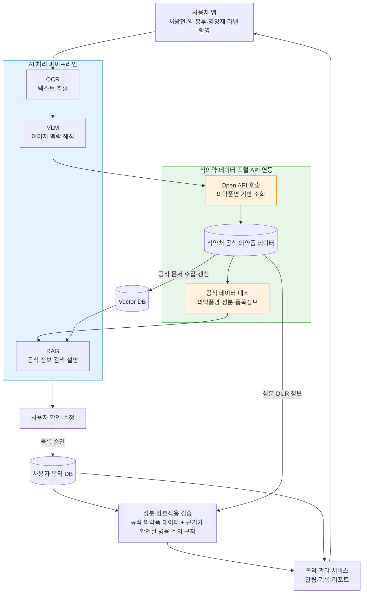

# E2-1

# AI 기반 개인 맞춤형 복약 지도 서비스

> **VLM · OPEN API** 기술을 활용해 의약품 등록을 간편하게 하고, 공신력 있는 의약품 정보를 바탕으로 복약 관리를 지원하는 디지털 헬스케어 서비스입니다.

## 1. 프로젝트 개요

### 배경 및 문제 정의

고령화 시대로 접어들며 만성질환 관리의 중요성이 커지면서 여러 의약품을 동시에 복용하는 사용자가 증가하고 있습니다. 또한 건강관리를 위한 영양제 섭취도 보편화되어 개인이 관리해야 할 복약 정보가 복잡해지고 있습니다.

기존 복약 관리 방식은 다음과 같은 어려움이 있습니다.

- **약물 상호작용 위험:** 처방약과 영양제의 중복 성분 및 병용 주의사항을 확인하기 어렵습니다.
- **정보의 분산:** 의약품 정보, 복약 일정, 실제 복용 기록이 서로 다른 곳에 흩어져 있습니다.
- **종합적인 복약 관리의 어려움:** 여러 의약품의 복용 여부를 기억하고 기록하기 어렵습니다.

### 프로젝트 목표

단순한 복약 알림 또는 알약 식별을 넘어, 사용자가 의약품 정보를 **쉽게 등록하고, 신뢰할 수 있는 근거를 확인하며, 지속적으로 복약 이력을 관리**할 수 있도록 지원합니다.

특히 **OCR로 텍스트를 추출**하고 **VLM으로 문서 및 이미지 맥락을 해석**한 뒤 **식품의약품안전처의 공식 데이터로 대조**하여 의약품 등록 과정을 보조합니다. **OPEN API**를 호출하여 근거 자료를 검색하고 이해하기 쉬운 안내를 제공하는 것을 목표로 합니다.

## 2. 주요 사용자

| 사용자                               | 이용 목적                                            |
| ------------------------------------ | ---------------------------------------------------- |
| **만성질환·다약제 복용자 (50~70대)** | 고혈압, 당뇨병 등 장기간 복용하는 여러 의약품의 관리 |
| **건강관리 관심 사용자 (20~40대)**   | 비타민, 오메가3, 유산균 등 다양한 영양제 관리        |
| **보호자 및 가족 구성원**            | 동의한 가족의 복약 현황 및 기록 확인                 |

## 3. 주요 기능

### 3.1. AI 의약품 자동 등록

1. 사용자가 **처방전, 약 봉투 또는 영양제 라벨을 촬영**합니다.
2. **OCR**이 약품명, 용량, 복용법 등 문자를 추출합니다.
3. **VLM**이 이미지의 맥락과 문서 구조를 해석해 추출 정보를 보완합니다.
4. 추출 결과를 **식약처 의약품 데이터와 대조**합니다.
5. 사용자가 결과를 **확인·수정한 후 등록**하면, 확정한 복용 지시에 따라 복약 일정에 추가합니다.
6. 자동 인식이 어려운 경우 **공식 의약품 데이터 검색을 통한 수동 등록**을 지원합니다.

### 3.2. 약물 상호작용 및 주의사항 안내

- 새 약을 등록하면 미리 등록한 영양제와 **성분을 비교**합니다.
- 중복 성분을 표시하고, 공식 자료에서 **병용 주의 근거가 확인된 조합**은 약사에게 확인할 항목을 안내합니다.
- 근거 자료에서 확인할 수 없는 조합은 **‘확인 가능한 정보 없음’**으로 표시합니다.
- **식품·생활습관 관련 주의사항** 확인
- 안내 결과에 **근거 출처** 표시

> **안전 원칙:** 중복 성분·상호작용 검토는 공식 데이터를 우선하며, 생성형 AI가 자체 판단만으로 안전성을 확정하지 않도록 설계합니다.

### 3.3. 복약 일정 및 이력 관리

- 등록 의약품에 따른 **복약 일정** 관리
- 복용 여부와 **복약 이력** 기록
- **복용률, 누락 빈도, 시간대별 복약 패턴** 분석
- **주간·월간 리포트** 제공

### 3.4. 가족·보호자 공유

- 사용자의 **명시적인 동의**에 따른 복약 정보 공유
- 보호자 권한에 맞춘 복약 현황 및 리포트 열람

## 4. 핵심 기술 및 아키텍처

### 4.1. 적용 기술

| 기술                                     | 역할                                                 |
| ---------------------------------------- | ---------------------------------------------------- |
| **OCR**                                  | 처방전·약 봉투·라벨에 포함된 텍스트 추출             |
| **VLM (Vision-Language Model)**          | 이미지의 맥락, 라벨 구조 및 누락 가능 정보 해석      |
| **식의약 Open API**          | 	의약품 정보 조회 및 대조     |
| **RAG (Retrieval-Augmented Generation)** | 공식 의약품 정보 검색을 기반으로 근거 있는 설명 생성 |
| **Vector DB**                            | 검색을 위한 의약품 문서 임베딩 저장 및 유사도 검색   |
| **규칙 기반 검증**                       | 공식 자료 기반 중복 성분 및 병용 주의사항 확인       |
| **사용자 DB**                            | 등록 의약품, 복약 일정, 복용 이력 및 설정 관리       |

### 4.2. 기술 아키텍처

### 4.3. 처리 흐름

**촬영 → OCR 추출 → VLM 해석 → 공식 데이터 검색(식의약 데이터 포털 API, RAG) → 사용자 확인 및 수정 → DB 등록 → 성분·상호작용 검증 → 복약 관리 및 리포트**

- **AI 인식 단계:** OCR과 VLM을 조합해 약품명과 복용 정보를 구조화합니다.
- **근거 검색 단계:** 식약처 등의 검증 가능한 자료를 검색하고 출처를 연결합니다.
- **등록 단계:** 오류 가능성을 고려해 사용자 확인을 필수로 둡니다.
- **안전성 확인 단계:** 공식 데이터와 검증 규칙으로 확인 가능한 위험 신호를 탐지합니다.
- **서비스 단계:** 등록 정보와 복용 기록을 활용해 알림과 리포트를 제공합니다.

## 5. 데이터 보안 및 안전성

의약품 및 건강 관련 데이터의 민감성을 고려하여 다음 원칙을 적용합니다.

- **데이터 품질:** 의약품 데이터 정기 갱신, 오류 검증 및 사용자 수정 절차 운영
- **출처 투명성:** AI 안내에 근거 자료와 출처 제공
- **개인정보 보호:** 사용자 동의에 기반한 건강정보 수집 및 처리
- **접근 제어:** 사용자 인증 및 보호자별 정보 열람 권한 관리
- **데이터 보호:** 전송 및 저장 과정에서 개인정보 보호를 위한 암호화 적용
- **전문가 검토:** 고위험 안내의 한계를 명시하고 향후 약사 등 전문가의 품질 검증 체계 도입

## 6. 기대 효과

### 사용자 관점

- **편의성 향상:** 의약품 등록 자동화로 정보 입력 부담 감소
- **안전한 사용 지원:** 중복 성분과 상호작용 주의사항에 대한 인식 향상
- **건강관리 습관 형성:** 복약 이력 및 맞춤형 피드백으로 꾸준한 복약 지원

### 비즈니스 관점

- AI 기반 **디지털 헬스케어 시장** 진입
- 사용자별 복약 관리 기능을 통한 **지속적인 서비스 이용** 유도
- **약국·병원·헬스케어 기업과의 B2B 제휴** 가능성
- **프리미엄 가족 관리 및 복약 리포트** 기능을 통한 수익 모델 확장

## 7. 개발 로드맵

| 단계                            | 주요 목표                     | 범위                                                                          |
| ------------------------------- | ----------------------------- | ----------------------------------------------------------------------------- |
| **1단계 · MVP**                 | 의약품 등록 및 기본 정보 조회 | OCR·VLM 기반 입력 보조, 공식 데이터 조회, 사용자 확인 및 등록, 기본 복약 일정과 기록 |
| **2단계 · AI 및 안전성 고도화** | 정보 신뢰성 및 개인화 강화    | RAG 근거 제시, 중복 성분 및 병용 주의 안내, 복약 분석 및 리포트                   |
| **3단계 · 서비스 확장**         | 전문가·기관 연계 및 가족 관리 | 약사 등 전문가 검증, 보호자 공유, 병원·약국 협업 검토                         |
| **4단계 · 플랫폼 발전**         | 개인 맞춤형 건강관리 플랫폼   | 복약 이력과 생활 패턴 기반 관리 기능 고도화                                   |

## 8. 향후 발전 방향

**AI를 통한 간편한 등록**, **검증 가능한 의약품 정보**, **지속적인 복약 이력 관리**를 결합해 누구나 자신의 약과 영양제를 보다 쉽고 안전하게 관리할 수 있는 서비스를 지향합니다.
